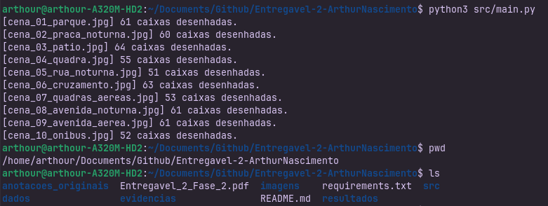
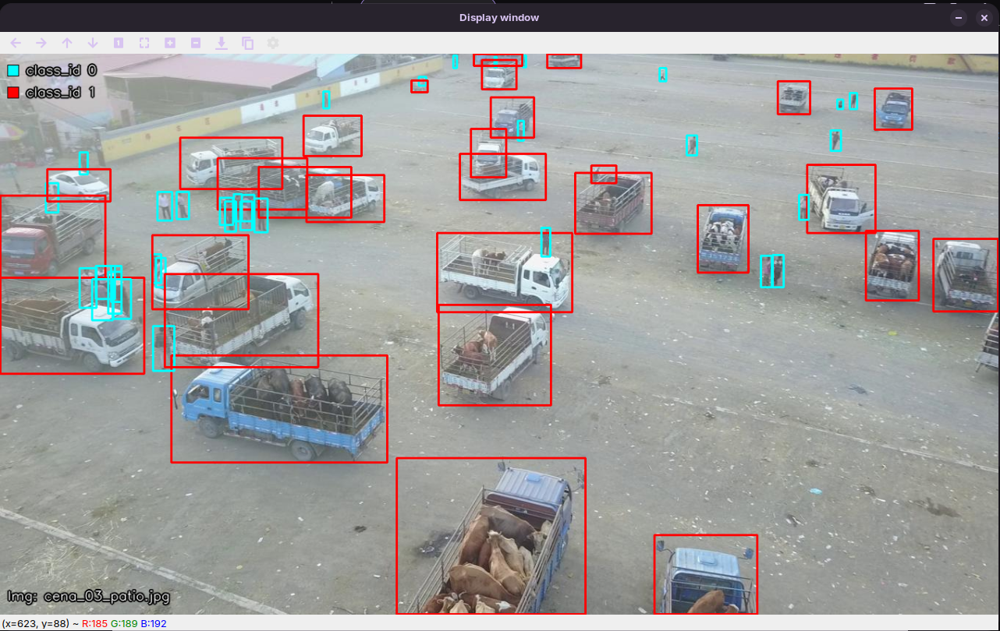

# Entregável 2 — 2a Fase PS Harpia

# Autor: Arthur Nascimento
# [GitHub](https://github.com/leKisho)

Programa desenvolvido em Python para visualizar imagens com *bounding boxes* a partir de anotações fornecidas em um arquivo CSV.

## Objetivo

O programa lê as anotações de `dados/anotacoes.csv`, agrupa as detecções por imagem e desenha as caixas delimitadoras correspondentes sobre as imagens originais.

As caixas são diferenciadas por cor conforme o identificador da classe:
- **Classe 0:** ciano.
- **Classe 1:** vermelho.

A imagem também apresenta sua identificação e uma legenda. As imagens anotadas são salvas na pasta `resultados`, preservando os arquivos originais.

## Dependências

O programa utiliza Python 3 e a biblioteca OpenCV (`opencv-python`). A biblioteca `csv`, utilizada para ler as anotações, faz parte da biblioteca padrão do Python.

Para instalar as dependências, execute na raiz do repositório:

```bash
python3 -m venv .venv
source .venv/bin/activate
python -m pip install -r requirements.txt
```

## Execução

Com as dependências instaladas, execute:

```bash
python src/main.py
```

O programa apresenta as imagens anotadas individualmente, em ordem alfabética.

- **Espaço:** avança para a próxima imagem.
- **q:** encerra a visualização.

As caixas são desenhadas na resolução original antes de qualquer redimensionamento para exibição.

### Exemplo de execução



Durante a execução, as imagens são apresentadas em uma janela de visualização, com a identificação da imagem e a legenda das classes.



## Classes

**Deteccao:** representa uma caixa delimitadora, armazenando o identificador da classe e as coordenadas dos seus limites. Também é responsável por desenhar a caixa na imagem com a cor correspondente.

**ImagemAnotada:** representa uma imagem e suas respectivas detecções. Armazena as informações da imagem, reúne as caixas delimitadoras e gera a versão anotada para salvamento e visualização.
